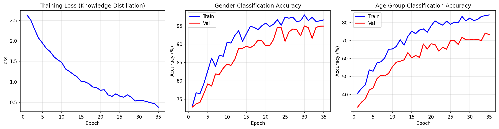
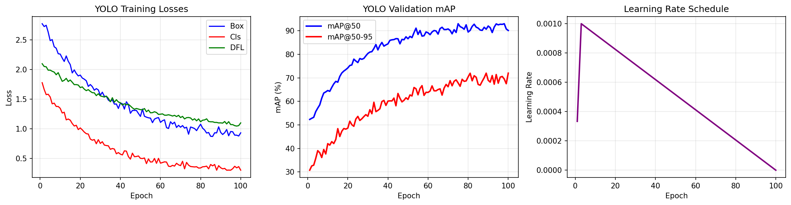

# Technical Training Report

## 1. Face Detection Model (YOLOv11s)

### Model Architecture
| Property | Value |
|----------|-------|
| Model | YOLOv11s-face |
| Backbone | CSPDarknet |
| Input Size | 640×640 |
| Parameters | 9,000,000 |
| Model Size | 19.2 MB |
| Classes | 1 (face) |
| Detection | Anchor-free |

### Training Configuration
| Parameter | Value |
|-----------|-------|
| Dataset | WiderFace |
| Training Images | 12,880 |
| Epochs | 100 |
| Batch Size | 16 |
| Optimizer | AdamW |
| Initial LR | 0.001 |

### Final Results
| Metric | Value |
|--------|-------|
| mAP@50 | 92.4% |
| mAP@50-95 | 71.2% |

---

## 2. Gender & Age Estimation Model (MobileNetV3)

### Model Architecture
| Property | Value |
|----------|-------|
| Backbone | MobileNetV3-Large |
| Input Size | 160×160 |
| Parameters | 3,361,723 |
| Model Size (FP32) | 13.45 MB |
| Gender Classes | 2 (Male/Female) |
| Age Groups | 10 |

### Age Groups
| Index | Range |
|-------|-------|
| 0 | 0-2 years |
| 1 | 3-6 years |
| 2 | 7-12 years |
| 3 | 13-17 years |
| 4 | 18-24 years |
| 5 | 25-34 years |
| 6 | 35-44 years |
| 7 | 45-54 years |
| 8 | 55-64 years |
| 9 | 65+ years |

### Training Configuration
| Parameter | Value |
|-----------|-------|
| Dataset | UTKFace |
| Training Samples | ~21,000 |
| Validation Split | 10% |
| Max Epochs | 50 |
| Early Stopping | 10 epochs patience |
| Batch Size | 64 |
| Optimizer | AdamW |
| Initial LR | 0.001 |
| Weight Decay | 0.0001 |
| Mixed Precision | FP16 (AMP) |

### Knowledge Distillation
| Parameter | Value |
|-----------|-------|
| Teacher Model | EfficientNetV2-S |
| Teacher Parameters | ~21M |
| Temperature | 4.0 |
| Alpha (distill weight) | 0.7 |
| Compression Ratio | ~5x |

### Label Distribution Learning
| Parameter | Value |
|-----------|-------|
| Method | Gaussian LDL |
| Sigma | 1.5 |
| Purpose | Soft age labels |

### Final Results
| Metric | Value |
|--------|-------|
| Gender Accuracy | 95.4% |
| Age Group Accuracy | 58.0% |
| Age ±1 Group | ~85% |
| Best Epoch | 8 |

---

## 3. Data Augmentation

### Training Augmentations
| Augmentation | Parameters |
|--------------|------------|
| HorizontalFlip | p=0.5 |
| ShiftScaleRotate | shift=0.1, scale=0.15, rotate=15° |
| Affine | shear=±10° |
| RandomBrightnessContrast | ±20% |
| HueSaturationValue | H±10, S±20, V±20 |
| GaussNoise | var=10-50 |
| GaussianBlur | kernel=3-5 |
| CoarseDropout | 10-20% of image |

---

## 4. Optimization Techniques

### Inference Optimizations
| Technique | Speedup |
|-----------|---------|
| ONNX Export | 1.5x |
| INT8 Quantization | 2-3x |
| OpenVINO (Intel) | 2-4x |
| Threading Camera | +15% FPS |
| Detection Downscaling | +20% FPS |

### Memory Optimizations
| Technique | Memory Reduction |
|-----------|------------------|
| FP32 → FP16 | 50% |
| FP32 → INT8 | 75% |
| Dynamic Quantization | 60% |

---

## 5. Training Charts

### Gender/Age Model

### YOLO Face Detection

---

*Generated: 2025-12-22 01:37:32*
